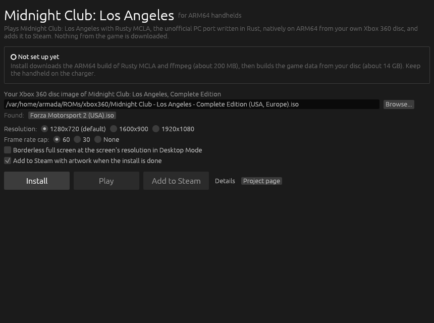
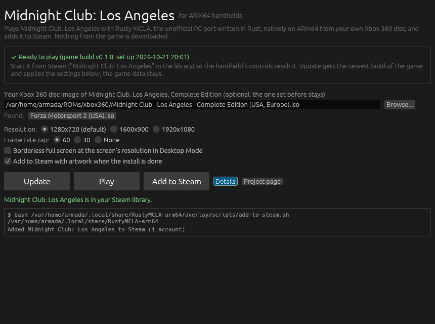

# rusty-mcla-arm64

*Midnight Club: Los Angeles* (Xbox 360, 2008) natively on ARM64 Linux
handhelds such as the Retroid Pocket 6 with ArmadaOS, through
[Rusty MCLA](https://github.com/holdmysocks/rusty-mcla), the unofficial PC
port written in Rust. Rusty MCLA is not an emulator or a recompilation: it is
a new engine that reads the game's data from your own disc and draws with
wgpu, which on Linux means Vulkan, straight onto the handheld's Turnip driver.
A launcher installs the ARM64 build of the game from this repository's
releases, builds the game data from your disc with the game's own install
tool and adds the game to Steam with its artwork, like the launchers of
[pinyon-shift-arm64](https://github.com/Ken5998/pinyon-shift-arm64) and
[road-trip-arm64](https://github.com/Ken5998/road-trip-arm64).

**Status:** Rusty MCLA is in early development upstream (Windows only so far)
and this is its first ARM64 Linux build. CI builds it on an ARM64 runner and
checks in Fedora 44 (the base of ArmadaOS) that it finds every library, opens
a Vulkan window and that a real install gets ffmpeg with the Xbox audio
decoders; it has not yet been played on a handheld. Expect the bugs upstream
lists, and report ARM64-only ones here.

This repository holds scripts, one patch and the launcher. Releases carry the
ARM64 build of the game (GPL-3.0, with its source), never any game data: the
game data is built on the handheld from your disc, and none may be published
here.

## What you need

- Your own Xbox 360 disc image (`.iso`) of *Midnight Club: Los Angeles,
  Complete Edition (USA, Europe)*.
- About 16 GB free for the game data (13.7 GB once built).
- `git`, `python3`, `curl` and `tar` on the handheld, as ArmadaOS has.

## With the launcher



1. In Desktop Mode, download `RustyMCLA-Launcher-linux-arm64.tar.gz` from
   [Releases](https://github.com/Ken5998/rusty-mcla-arm64/releases/latest)
   and unpack it.
2. Start `RustyMCLA/rusty-mcla-launcher`. It looks for Xbox 360 disc images in
   your home folder, Downloads, ROM and emulation folders and SD cards;
   **Browse...** picks others.
3. Choose the resolution and the frame rate cap, then press **Install**. It
   fetches this repository's scripts and runs `scripts/install.sh` (below):
   the game build and ffmpeg download, then the game data is built from your
   disc, with its progress on the bar; **Details** shows the output. Keep the
   handheld on the charger. When it is done, **Midnight Club: Los Angeles** is
   in the Steam library.



**Update** gets the newest build of the game from the releases, checks the
game data and applies changed settings. The launcher's log is
`~/.local/share/RustyMCLA-arm64/launcher.log`.

## From a terminal

In Desktop Mode:

```bash
git clone https://github.com/Ken5998/rusty-mcla-arm64
rusty-mcla-arm64/scripts/install.sh "/path/to/Midnight Club - Los Angeles.iso"
```

Everything goes to `~/.local/share/RustyMCLA-arm64`, the folder the launcher
uses too. Run it again with `-` for the disc to update the game and rewrite
the settings while keeping the disc and the data:

```bash
MCLA_RESOLUTION=1600x900 rusty-mcla-arm64/scripts/install.sh -
```

| Variable | Default | What it does |
| --- | --- | --- |
| `MCLA_RESOLUTION` | `1280x720` | The game's window. 1280x720 is the Xbox 360's own resolution and gives the most frames per second; Steam's Game Mode scales the window to the screen. |
| `MCLA_WINDOW_MODE` | `windowed` | `windowed`, `borderless` (full screen at the screen's resolution) or `fullscreen`. |
| `MCLA_FPS_CAP` | `60` | The frame rate cap, `0` for none (vsync stays on). |
| `MCLA_ADD_TO_STEAM` | `0` | `1` adds the game to Steam at the end (`scripts/add-to-steam.sh` does it later). |
| `MCLA_ARTWORK` | `1` | `0` skips the Steam artwork. |

The game starts with `~/.local/share/RustyMCLA-arm64/game/mcla.sh`.

## Playing

Start the game from Steam: on ArmadaOS the handheld's controls reach a game
only when Steam launches it. Steam adds it as a non-Steam game (native, no
Proton). Its artwork is drawn on the handheld at install time: the game takes
two screenshots of itself from your data (your car at the Hollywood garage, at
night and at dusk) and `steam-art` lays the title over them. Steam is closed
for a moment and started again, since it would otherwise overwrite the new
entry.

- **Settings the install writes** into the game's own
  `~/.local/share/RustyMCLA/settings.toml`: the window mode and size, vsync,
  the frame rate cap and the data folder. Everything else stays as the game
  has it, with its saves and logs in the same folder.
- **Resolution:** 1280x720 is the lightest. Alt+Enter cycles the game between
  a window, borderless and full screen.
- **Speed on Adreno GPUs:** the city is drawn with one program per
  material instead of one for all of them, which Turnip's compiler turns
  into a program four to eight times shorter. They are built in the
  background the first few minutes of play (the game is slower until
  then) and kept by Mesa's shader cache for the next start; the ones you
  have drawn are listed in `city-programs.txt` and built again as the game
  starts, before they are needed.
  `MCLA_CITY_SPEC=0` draws as upstream does. The game also prepares the
  next frame while the GPU draws the last one instead of waiting for the
  desktop to show each frame first; `MCLA_PRESENT_NOTIFY=1` waits as
  upstream does.
- **Overlay flicker:** if MangoHud or the Steam overlay flicker over the game
  on the Retroid Pocket 6, the launcher's **Turn it off** button adds the
  kernel option `msm.enable_preemption=0` (undo with
  `sudo rpm-ostree kargs --delete=msm.enable_preemption=0`).

## What is here

| Path | What it does |
| --- | --- |
| `upstream.json` | The Rusty MCLA commit the build is made from, and the Rust version. |
| `patches/` | Changes to Rusty MCLA for ARM64 Linux: SDL (used only for game pads) builds without X11 or Wayland; GPU time per render pass (`MCLA_GPU_TIMES=1`); the city's programs built once per material, which Adreno GPUs need, frames prepared while the GPU draws, and the city programs drawn before built at start (see Playing). |
| `scripts/build-game.sh [OUT]` | Builds `mcla` (the game), `mcla-tool` (its install tool) and `steam-art`, and packs them with the patched source for a release. |
| `scripts/install.sh DISC\|- [DIR]` | Downloads the game build and ffmpeg ([BtbN/FFmpeg-Builds](https://github.com/BtbN/FFmpeg-Builds), checked against its SHA-256), builds the game data with `mcla-tool install`, writes the settings and `game/mcla.sh`, and draws the artwork. |
| `scripts/configure.py` | Sets keys of the game's `settings.toml`, keeping the rest. |
| `scripts/artwork.sh [DIR]`, `tools/steam-art/` | The game's screenshots and the artwork drawn over them. |
| `scripts/add-to-steam.sh [DIR]` | Adds the game to Steam with its artwork (`scripts/add-to-steam.py` writes the entry). |
| `launcher/` | The launcher window (Rust, egui): runs `scripts/install.sh` from a fresh copy of this repository, then plays the game or adds it to Steam. |
| `tests/` | The install with a stand-in game build, and the Steam entry against a made-up Steam folder. |
| `.github/workflows/ci.yml` | The ARM64 build, its checks in Fedora 44 and the launcher, on ARM64 runners. |
| `.github/workflows/release.yml` | Publishes the launcher, the game build and its source as a release. |

## License

GPL-3.0-only, as Rusty MCLA (see `LICENSE` and `NOTICE`). This is an
unofficial fan project, not affiliated with, authorised or endorsed by
Rockstar Games or Take-Two Interactive; the game is yours.
